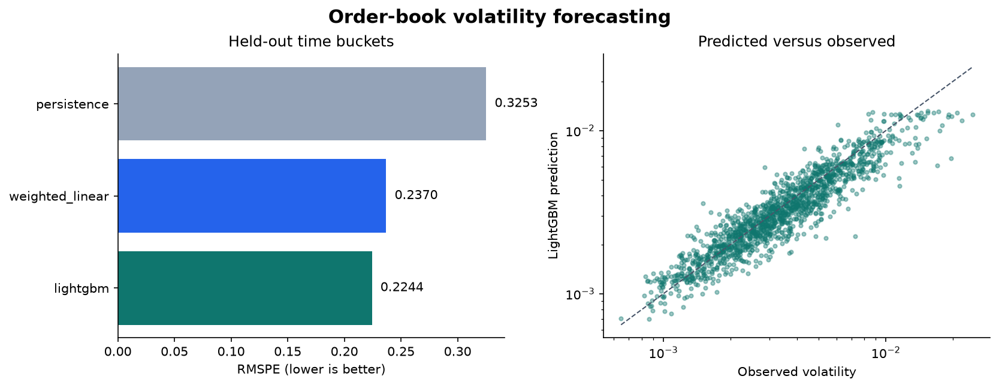
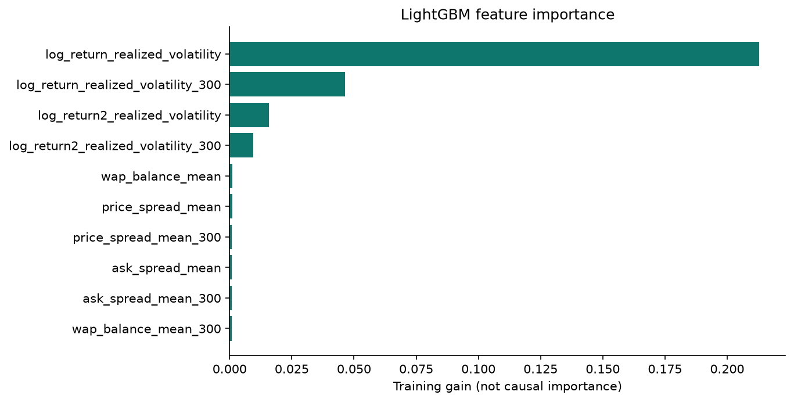

# Order Book Volatility Forecasting: Microstructure Features vs. Regression Baselines

Empirical benchmark predicting forward 10-minute realized volatility across five liquid equities (`stock_id` `0, 1, 2, 3, 61`, 19,150 observations across 3,830 time buckets) from the Optiver Realized Volatility dataset. Level-1 and Level-2 order book snapshots are used to compare LightGBM (inverse-variance sample weighted) against per-stock Weighted Linear Regression and Previous-Window Persistence.

## Validation Setup

- **Group-Disjoint Time-Bucket Validation:** Observations are split strictly by `time_id` via `GroupShuffleSplit` into `fit` (64%, 12,255 rows), `validation` (16%, 3,065 rows), and `test` (20%, 3,830 rows / 766 buckets per stock). Grouping ensures all five stocks from a given 10-minute bucket land in the same fold, preventing contemporaneous cross-stock market-shock overlap across splits.
- **Anonymized Buckets (Not Chronological Walk-Forward):** Because public Optiver `time_id` labels are shuffled and unmapped to calendar timestamps, this grouped holdout measures cross-bucket generalization rather than chronological decay across sequential trading months.
- **Statistical Accuracy vs. Trading P&L:** RMSPE measures volatility prediction accuracy only; monetizing these forecasts requires modeling spread crossing, queue position, inventory risk, and latency.

## Empirical Results (RMSPE)

### Validation & Test Summary

| Model | Validation RMSPE | Test RMSPE | Test vs. Persistence | Rows (Test) |
|:---|---:|---:|---:|---:|
| **Previous-Window Volatility (Persistence)** | 0.31278 | 0.32529 | Baseline | 3,830 |
| **Per-Stock Weighted Linear Regression** | 0.24219 | 0.23697 | -27.2% | 3,830 |
| **LightGBM (18 Book Features)** | **0.23732** | **0.22439** | **-31.0%** | 3,830 |

*Note on predictor scaling:* WLS predictors are standardized inside `StandardScaler` so the closed-form solution stays numerically stable across `scikit-learn` versions without changing fitted values.



### Per-Stock Test RMSPE (`766` Test Buckets per Stock)

| Stock ID | Persistence | Weighted Linear | LightGBM | LightGBM vs. Linear | LightGBM vs. Persistence |
|:---|---:|---:|---:|---:|---:|
| **Stock 0** | 0.40155 | 0.28006 | **0.27253** | +2.7% | -32.1% |
| **Stock 1** | 0.31002 | 0.22825 | **0.21742** | +4.7% | -29.9% |
| **Stock 2** | 0.33890 | 0.24369 | **0.21083** | +13.5% | -37.8% |
| **Stock 3** | 0.32681 | 0.24165 | **0.23854** | +1.3% | -27.0% |
| **Stock 61** | 0.22374 | 0.18017 | **0.16990** | +5.7% | -24.1% |

I focused on `stock_id` `0, 1, 2, 3, 61` because they span diverse volatility profiles across the first partition files (`Stock 0` at `0.40155` persistence RMSPE vs. `Stock 61` at `0.22374`) while keeping aligned `3,830` buckets tractable. Per-stock errors show that LightGBM's non-linear gain over WLS is unevenly distributed—largest in `Stock 2` (`+13.5%`), where residual tail spikes correlate with late-bucket 300s RV acceleration, and marginal in `Stock 3` (`+1.3%`), which remains largely linear in trailing `WAP1` RV.

### Paired Bucket-Bootstrap Intervals (`1,000` Resamples)

Resampling held-out test buckets `1,000` times with replacement quantifies bucket-level sampling variability relative to persistence:

| Model vs. Persistence | Mean Test RMSPE Diff | 95% Bootstrap CI | Resamples |
|:---|---:|:---:|---:|
| **Weighted Linear Regression** | -0.08832 | [-0.10432, -0.07184] | 1,000 |
| **LightGBM Ensemble** | **-0.10090** | **[-0.12413, -0.07927]** | 1,000 |



## Microstructure Features & Loss Function

For each 10-minute bucket ($t \in [0, 600]$ s) and its recent sub-bucket ($t \in [300, 600]$ s), `18` features are extracted from Level-1 and Level-2 order book updates (`Bid/Ask Price 1–2`, `Bid/Ask Size 1–2`):

- **Weighted Average Price & Log Returns:**
  $$\mathrm{WAP}_k(t) = \frac{P_{\mathrm{bid},k}(t) V_{\mathrm{ask},k}(t) + P_{\mathrm{ask},k}(t) V_{\mathrm{bid},k}(t)}{V_{\mathrm{bid},k}(t) + V_{\mathrm{ask},k}(t)}, \qquad r_{t_m} = \ln\left(\frac{\mathrm{WAP}(t_m)}{\mathrm{WAP}(t_{m-1})}\right)$$
- **Forward 10-Minute Target & Loss:** Target $y_i = \sqrt{\sum_m r_{t_m}^2}$ is the forward 10-minute realized volatility (unannualized over the 600-second horizon). To match the **RMSPE** metric ($\sqrt{\frac{1}{N} \sum_i ((y_i - \hat{y}_i)/y_i)^2}$), both WLS and LightGBM train with inverse-variance sample weights $w_i \propto 1 / y_i^2$.
- **Additional Features:** Sub-bucket `WAP1`/`WAP2` realized volatility, relative bid-ask spread, Level 1–2 bid and ask spreads, `|WAP1 - WAP2|` valuation gap, aggregate top-two-level depth, and absolute volume imbalance. Split gain is dominated by full-window `WAP1` volatility (~0.2128), followed by 300s decay features (~0.0465) and depth/spread terms.

## Reproducibility

```bash
git clone https://github.com/Juliansaiani/order-book-volatility-forecasting.git
cd order-book-volatility-forecasting
python -m pip install -r requirements.txt
python -m pip install -e '.[dev]'
python -m pytest -q
python -m orderbook_volatility.pipeline
```

Raw parquet partitions are fetched from the pinned revision recorded in [config.json](config.json) and verified via SHA-256 (`data/manifest.json`). Diagnostic tables and plots are available in [notebooks/research.ipynb](notebooks/research.ipynb) and `artifacts/`.

## License

CC0 1.0 Universal — Research developed in 2025; packaged and published in 2026. Copyright (c) 2025 Julian Saiani. Raw data remains subject to the [Optiver Realized Volatility Prediction](https://www.kaggle.com/competitions/optiver-realized-volatility-prediction/data) competition terms.
